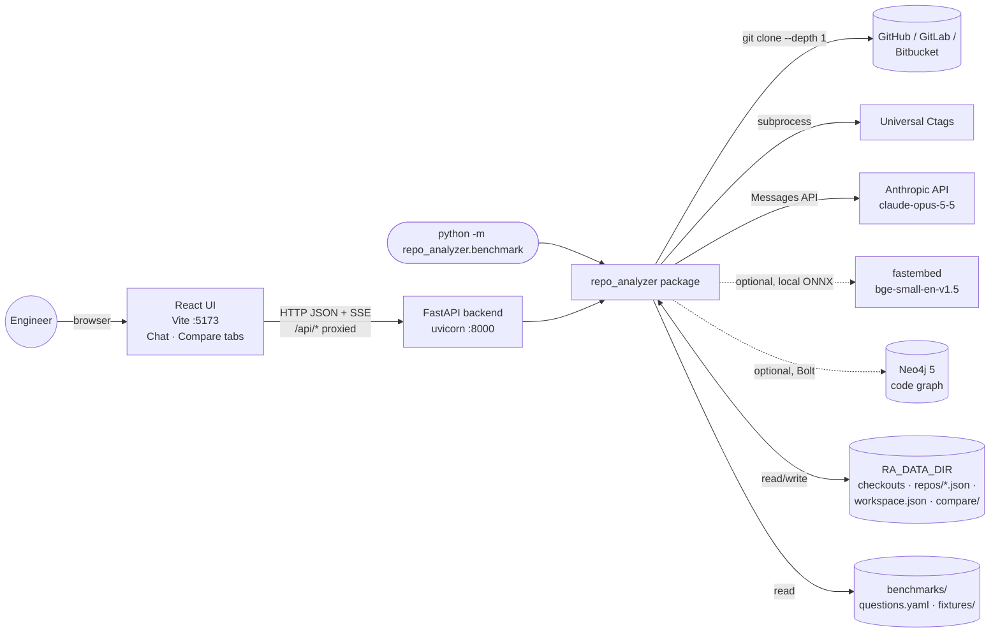
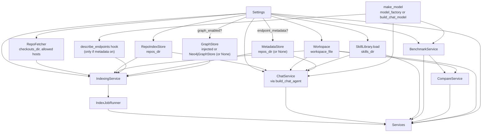
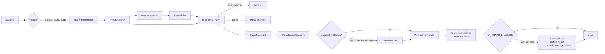
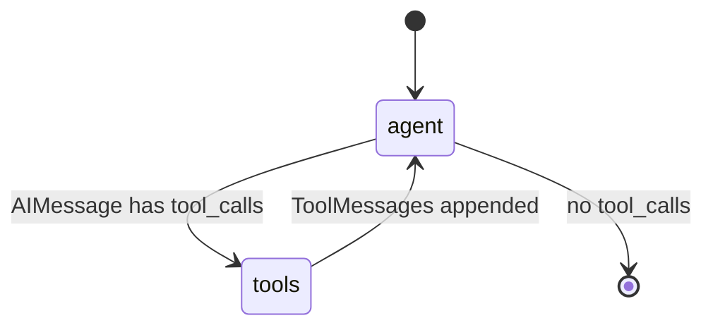

# Architecture

Repository Analyzer answers questions about a small set of Git repositories. It clones
them, writes **one plain JSON index per repository** (file tree, declared dependencies,
functions/classes/imports from Universal Ctags), and lets a Claude agent orchestrated by
LangGraph answer questions by reading those indexes, searching the checkouts for exact
text, and reading files. Answers cite `repo/path:line`.

Two optional additions sit on top of that core:

- **Endpoint metadata** (`RA_ENDPOINT_METADATA=true`): at index time the model is asked
  once per repository to describe every HTTP endpoint's data flow; the result is written
  next to the JSON index and exposed to the agent as a tool.
- **Code graph** (`RA_GRAPH_ENABLED=true`): after indexing, each repository's endpoints,
  functions, calls and table reads/writes are extracted with Python's `ast` and loaded
  into Neo4j, so a request can be traced from the router to the database. Derived from
  the checkout on every run; the JSON indexes stay the source of truth.
- **Benchmark and Compare**: a CLI benchmark and a web "Compare" tab that answer the same
  question under four retrieval approaches (the Chat agent, JSON + metadata, tools only,
  JSON + embeddings) and report correctness, tokens and latency.

There is no vector database. The only embeddings are the optional, in-memory ones used by
the benchmark's `json-embeddings` approach.

Related docs: [datamodels.md](datamodels.md) (every type and file format),
[dataflow.md](dataflow.md) (how data moves through indexing, chat, compare and the
benchmark).

---

## 1. System context



| External dependency | Used for | Required for |
| --- | --- | --- |
| `git` on `PATH` | Shallow clone, `rev-parse HEAD`, `branch --show-current` | Indexing remote repositories |
| Universal Ctags (`RA_CTAGS_PATH`) with JSON output | Functions, classes, imports | Indexing (hard requirement: indexing fails without it) |
| Anthropic API (`ANTHROPIC_API_KEY`) | Agent model; endpoint metadata; benchmark judge | Chat, Compare, benchmark, metadata |
| `fastembed` (extra `embeddings`) | Local sentence embeddings | Only the `json-embeddings` approach |
| `pyyaml` (extra `benchmark`, also in `dev`) | Reading `benchmarks/questions.yaml` | Benchmark and Compare |
| Neo4j 5 + `neo4j` driver (extra `graph`) | Code graph: endpoint → function → table traces | Only with `RA_GRAPH_ENABLED=true` |
| Local filesystem (`RA_DATA_DIR`, default `.data`) | Checkouts, indexes, metadata, workspace state | Everything |

The server binds to `127.0.0.1` by default: the API has **no authentication** and can
clone repositories and spend API tokens, so it is meant for a single local user.

---

## 2. Process and deployment shape

- **One process, one workspace.** A single uvicorn worker holds all long-lived objects.
  There is no database, queue, or cache server.
- **Background indexing** runs on a worker thread (`asyncio.to_thread`) so the event loop
  stays free for `GET /workspace` polls and chat streams. One indexing job at a time.
- **Conversation memory** is an in-process LangGraph `InMemorySaver`, keyed by the
  client's `thread_id`. Lost on restart, not shared across workers.
- **Compare targets** (indexed fixtures, metadata, embedding indexes) are cached in a
  process-level dict for the life of the server.
- **Persistent state** survives restarts: `workspace.json`, the per-repo JSON indexes and
  metadata files are reloaded at startup, so a restart does not require re-indexing.

Entry points:

| Command | Module | What it does |
| --- | --- | --- |
| `python -m repo_analyzer` / `repo-analyzer` | [`__main__.py`](../src/repo_analyzer/__main__.py) | Parses `--host` (default `127.0.0.1`), `--port` (8000), `--log-level`; runs uvicorn on `create_app()` |
| `python -m repo_analyzer.benchmark` | [`benchmark/__main__.py`](../src/repo_analyzer/benchmark/__main__.py) | Runs the known-answer benchmark and writes a report |

---

## 3. Layered view

```
┌──────────────────────────────────────────────────────────────────────────────┐
│ api/              HTTP boundary                                              │
│   app.py          create_app(): FastAPI, CORS, AnalyzerError → status code   │
│   routes.py       /health /skills /workspace /workspace/index /chat          │
│   compare_routes  /compare/status  /compare                                  │
│   schemas.py      Pydantic request/response models                           │
│   services.py     build_services(): the composition root                     │
├──────────────────────────────────────────────────────────────────────────────┤
│ benchmark/        Compare tab + CLI benchmark (uses ingestion, agent, retrieval)
│   approaches.py   4 approaches: tools + system prompt per approach            │
│   compare.py      CompareService: one question, all approaches, concurrently │
│   runner.py       BenchmarkRunner: every question × every approach, graded   │
│   setup.py        index fixtures, generate metadata, build embeddings        │
│   grading.py      key-fact matching, optional LLM judge                      │
│   questions.py    load benchmarks/questions.yaml                             │
│   report.py       summary.md, results.csv, answers.jsonl, run.json           │
│   service.py      BenchmarkService: credentials, fixtures, availability      │
├────────────────────────────────┬─────────────────────────────────────────────┤
│ ingestion/   (write side)      │ agent/   (read side)                        │
│   jobs.py      IndexJobRunner  │   service.py  ChatService → ChatEvent       │
│   pipeline.py  IndexingService │   graph.py    LangGraph agent ⇄ tools loop  │
│   fetcher.py   RepoFetcher     │   tools.py    tools (factory, closures)     │
│   scanner.py   scan_repository │   skills.py   SkillLibrary, system prompt   │
│   symbols.py   Ctags runner    │   usage.py    UsageTracker (tokens, latency)│
│   manifests.py manifest parse  │   prompts.py  default SYSTEM_PROMPT         │
│   repo_index.py RepoIndexStore │   llm.py      ChatAnthropic construction    │
│   metadata.py  endpoint metadata (LLM, optional)                             │
│   graph_extract.py  ast → files, functions, calls, endpoints, tables         │
│   graph_store.py    GraphStore protocol, Neo4jGraphStore, trace assembly     │
├────────────────────────────────┴─────────────────────────────────────────────┤
│ retrieval/embeddings.py   chunking, EmbeddingIndex, semantic_search tool     │
├──────────────────────────────────────────────────────────────────────────────┤
│ workspace.py   Workspace / WorkspaceState (current indexed set, atomic)      │
│ domain.py      Immutable value types (RepoSnapshot, SourceFile, Manifest…)   │
│ config.py      Settings (RA_* env vars, .env)                                │
│ errors.py      AnalyzerError hierarchy (user-presentable failures)           │
└──────────────────────────────────────────────────────────────────────────────┘
```

Dependencies point downward. `benchmark` builds on `agent`, `ingestion` and `retrieval`;
`agent` reads what `ingestion` writes; nothing below imports from `api` or `benchmark`.
(`ingestion/metadata.py` imports `agent/usage.py` for token accounting.)

### Module responsibilities

| Module | Responsibility | Key public names |
| --- | --- | --- |
| [`config.py`](../src/repo_analyzer/config.py) | All settings, `RA_`-prefixed env vars, `.env`. Derived paths. | `Settings`, `default_skills_dir`, `default_benchmarks_dir` |
| [`domain.py`](../src/repo_analyzer/domain.py) | Frozen, I/O-free value objects. | `RepoSnapshot`, `SourceFile`, `Manifest`, `PackageRef`, `Requirement`, `Ecosystem`, `DependencyScope` |
| [`errors.py`](../src/repo_analyzer/errors.py) | Expected failures whose messages are safe to show callers. | `AnalyzerError` + subclasses |
| [`workspace.py`](../src/repo_analyzer/workspace.py) | Current indexed set as an immutable snapshot, swapped atomically, persisted as JSON. | `Workspace`, `WorkspaceState`, `IndexedRepository` |
| [`ingestion/fetcher.py`](../src/repo_analyzer/ingestion/fetcher.py) | Validate sources, produce a local checkout. | `RepoFetcher`, `parse_remote_url` |
| [`ingestion/scanner.py`](../src/repo_analyzer/ingestion/scanner.py) | Walk a checkout, yield allow-listed UTF-8 text files. Shared by indexing, tools, metadata and embeddings. | `scan_repository`, `language_for` |
| [`ingestion/symbols.py`](../src/repo_analyzer/ingestion/symbols.py) | Run Universal Ctags once per repo; classify tags. | `extract_symbols_for_repository`, `probe_ctags`, `require_ctags` |
| [`ingestion/manifests.py`](../src/repo_analyzer/ingestion/manifests.py) | Pure parsers for `package.json`, `pyproject.toml`, `setup.cfg`, `requirements*.txt`, `go.mod`. | `parse_manifest` |
| [`ingestion/repo_index.py`](../src/repo_analyzer/ingestion/repo_index.py) | Assemble and atomically read/write the per-repo JSON index. | `build_repo_index`, `RepoIndexStore`, `index_filename` |
| [`ingestion/metadata.py`](../src/repo_analyzer/ingestion/metadata.py) | One model call per repo → per-endpoint data-flow notes; store next to the index. | `generate_endpoint_metadata`, `MetadataStore` |
| [`ingestion/graph_extract.py`](../src/repo_analyzer/ingestion/graph_extract.py) | Pure: Python `ast` + `.sql` migrations → graph records (functions, calls, FastAPI endpoints, tables, reads/writes). | `extract_graph`, `GraphRecords` |
| [`ingestion/graph_store.py`](../src/repo_analyzer/ingestion/graph_store.py) | Load records into Neo4j (one transaction per repo), read traces back; pure trace helpers. | `GraphStore`, `Neo4jGraphStore`, `assemble_trace`, `match_endpoint`, `graph_workspace_key` |
| [`ingestion/pipeline.py`](../src/repo_analyzer/ingestion/pipeline.py) | Fetch → scan → describe → write → (metadata) → swap workspace → delete stale → (code graph). | `IndexingService` |
| [`ingestion/jobs.py`](../src/repo_analyzer/ingestion/jobs.py) | Run the pipeline in the background, expose `JobStatus`. | `IndexJobRunner` |
| [`retrieval/embeddings.py`](../src/repo_analyzer/retrieval/embeddings.py) | 60-line chunks, cosine search, `semantic_search` tool. | `chunk_files`, `EmbeddingIndex`, `FastEmbedEmbedder` |
| [`agent/skills.py`](../src/repo_analyzer/agent/skills.py) | Load `skills/*/SKILL.md`, render the system prompt with the catalogue. | `SkillLibrary`, `build_system_prompt`, `BASE_PROMPT` |
| [`agent/tools.py`](../src/repo_analyzer/agent/tools.py) | Agent tools, built by factories that close over dependencies. | `build_tools`, `build_metadata_tool`, `build_list_files_tool` |
| [`agent/graph.py`](../src/repo_analyzer/agent/graph.py) | LangGraph `START → agent ⇄ tools → END`, with prompt caching. | `build_agent_graph` |
| [`agent/usage.py`](../src/repo_analyzer/agent/usage.py) | Sum tokens, cache tokens, LLM/tool calls and latency over a turn. | `UsageTracker` |
| [`agent/llm.py`](../src/repo_analyzer/agent/llm.py) | Build `ChatAnthropic`; fail clearly without a key. | `build_chat_model` |
| [`agent/service.py`](../src/repo_analyzer/agent/service.py) | Run one turn, map stream parts to `ChatEvent`s, translate failures. | `ChatService`, `build_chat_agent`, `chat_agent_tools_and_prompt` |
| [`benchmark/*`](../src/repo_analyzer/benchmark/) | Approaches, Compare service, CLI runner, grading, reports. | see §8 |
| [`api/services.py`](../src/repo_analyzer/api/services.py) | Composition root: the only place objects are wired together. | `build_services`, `Services` |
| [`api/routes.py`](../src/repo_analyzer/api/routes.py), [`api/compare_routes.py`](../src/repo_analyzer/api/compare_routes.py) | HTTP handlers. | `router` |
| [`api/app.py`](../src/repo_analyzer/api/app.py) | App factory, CORS, error → status mapping, router mounting. | `create_app` |

---

## 4. Composition root

All long-lived objects are built once in
[`build_services()`](../src/repo_analyzer/api/services.py) and stored on
`app.state.services`. Routes receive them through the `ServicesDep` dependency.



`create_app(settings, model_factory=..., benchmark_embedder_factory=..., graph_store=...)`
lets tests inject settings, a scripted chat model, a fake embedder and an in-memory
`GraphStore`. The graph store is only used when `settings.graph_enabled` is true; otherwise
`Services.graph_store` is `None` and nothing graph-related runs. When enabled,
`ensure_schema()` is attempted once at startup (failures are logged and retried on the
first sync), and the driver is closed in the app's lifespan shutdown. With a custom
`model_factory`, prompt caching is disabled and `BenchmarkService` does not require an
API key, because scripted models accept neither.

The chat model is **built lazily** (`ChatService.ensure_ready`) on the first chat request,
so the server starts and indexes without an API key.

---

## 5. HTTP API

| Method & path | Handler | Behaviour |
| --- | --- | --- |
| `GET /api/health` | `routes.health` | Probes Ctags (runs `ctags --version` and `--list-features` on every call); `llm_configured` (a non-empty `ANTHROPIC_API_KEY`), the model name, and `graph_available` (graph enabled and Neo4j answers `verify_connectivity`). |
| `GET /api/skills` | `routes.list_skills` | Names and descriptions of installed skills. |
| `GET /api/workspace` | `routes.get_workspace` | Current `WorkspaceState` + `JobStatus`. Polled by the UI while indexing. |
| `POST /api/workspace/index` | `routes.start_indexing` | **202.** Validates synchronously, starts a background job, returns immediately. Replaces the whole workspace. |
| `POST /api/chat` | `routes.chat` | SSE: `token`, `tool_call`, `sources`, `error`, `usage`, `done`. Pre-checks (non-empty workspace, model buildable) fail with a real status before the stream starts. |
| `GET /api/compare/status` | `compare_routes.compare_status` | Repositories that can be compared (benchmark fixtures if present, plus indexed repos) and which approaches can run, with reasons. |
| `POST /api/compare` | `compare_routes.compare` | SSE: one question under several approaches at once; every event is tagged with `approach`. Prepares the target (may index fixtures) on a thread before streaming. |

FastAPI's interactive docs are at `/docs`.

### Error handling

`AnalyzerError` subclasses are expected, user-presentable failures; a single handler maps
them to status codes. Anything else is a bug and surfaces as an opaque 500.

| Error | HTTP |
| --- | --- |
| `InvalidRepositorySourceError` | 400 |
| `InvalidBenchmarkRequestError` | 400 |
| `UnknownRepositoryError` | 404 |
| `IndexingInProgressError` | 409 |
| `WorkspaceEmptyError` | 409 |
| `RepositoryFetchError` | 502 |
| `LLMNotConfiguredError` | 503 |
| `CtagsError` | 503 |
| `BenchmarkUnavailableError` | 503 |
| `GraphUnavailableError` | 503 |
| `MetadataGenerationError` (in `ingestion/metadata.py`), `EmbeddingsUnavailableError` (in `retrieval/embeddings.py`) | not mapped → 500 if they ever escaped; in practice they are caught internally |

Errors inside an already-started SSE stream are delivered as an `error` event. Errors
inside an agent **tool** are returned to the model as text (`"Error: ..."`) so it can
correct itself.

CORS allows `GET`/`POST` with `Content-Type` from `RA_CORS_ORIGINS` (default
`http://localhost:5173`). In development Vite proxies `/api` to `127.0.0.1:8000`.

---

## 6. Ingestion subsystem



- **A run defines the whole workspace.** Afterwards exactly the requested repositories are
  indexed; previously indexed ones not in the request are removed.
- **All-or-nothing for indexes.** Every repository is fetched and described in memory
  before any JSON is written; a fetch failure leaves the previous indexes and workspace
  untouched (checkouts fetched before the failure may already be refreshed).
- **Fresh shallow clone every time** (`--depth 1 --single-branch --no-tags`).
- **Ctags runs once per repository**, fed the scanner's accepted file list on stdin.
- **Manifests are parsed by pure functions**; a malformed one is logged and skipped.
- **Endpoint metadata never fails indexing.** Any model, network or parse error is logged,
  the repo's metadata file is deleted, and indexing continues. Without an API key every
  repo simply ends up with no metadata.
- **The code graph never fails indexing either.** It is built last, after the workspace
  swap and stale cleanup: repos that left the workspace are deleted from the graph, then
  each repo's subgraph is replaced in one Neo4j transaction. Any exception (Neo4j down,
  driver missing, bad credentials) is logged per repo and indexing still succeeds.

### Code graph model

```
(Repo)-[:CONTAINS]->(File)-[:DECLARES]->(Function|Class)
(File)-[:IMPORTS]->(Module)
(Endpoint)-[:HANDLED_BY]->(Function)-[:CALLS {via, line}]->(Function)
(Function)-[:READS|WRITES {line}]->(Table)
```

Every node carries `ws` (a 12-character hash of the resolved `data_dir`, so the main app,
each Compare target and each benchmark run never overwrite each other in a shared
database) and `repo`. Extraction rules (`graph_extract.py`):

| What | How |
| --- | --- |
| Functions, classes, methods | Python `ast`; methods are `Class.method`; nested functions and lambdas fold into the enclosing function |
| Calls | By name: a name imported from an in-repo module links to that module's function; calls through modules from outside the repo (`httpx.post`) are skipped; otherwise unique-in-repo, else same file, else recorded as `unresolved` (a gap). `obj.m()` considers methods only; `self.m()` prefers the same class. A repo function passed as an argument (`cached(key, ttl, load)`) is a call `via: "reference"` |
| Endpoints | FastAPI `@router.get/post/put/patch/delete(...)` and `@router.api_route(..., methods=[...])` on `APIRouter(prefix=...)` / `FastAPI()` variables in the same module |
| Tables declared | `CREATE TABLE` in `.sql` files; SQLAlchemy `__tablename__` and `Table("name", ...)`; Django `models.Model` (`Meta.db_table` or `<app>_<model>`, abstract models skipped) |
| Reads / writes | SQL string literals and f-string literal parts starting with `SELECT/INSERT/UPDATE/DELETE/WITH`: `FROM`/`JOIN` read; `INSERT INTO`, `UPDATE x SET`, `DELETE FROM` write (`SELECT … FOR UPDATE` stays a read). SQLAlchemy `select(M)`, `session.query(M)`, `session.get(M, …)` read; `insert/update/delete(M)`, `session.add(M(…))` write. Django `M.objects.filter/get/all/…` read; `create/update/delete/bulk_create/…` write. When any table is declared, only declared names are kept |

`GraphStore.trace_endpoint(ws, repo, method, path)` matches the route (exact, then
`{param}` templates), follows `CALLS*0..6` from the handler, and returns depth-first steps
in call-line order with each function's tables and the trace's gaps
(`assemble_trace`). The agent tools that use it arrive in Phase 2.

Step-by-step sequence: [dataflow.md §2](dataflow.md#2-indexing-flow).

---

## 7. Agent subsystem

### Graph



- State is LangGraph's `MessagesState`.
- The **agent** node calls `model.bind_tools(tools).ainvoke([SystemMessage, *messages])`.
- The **tools** node is the prebuilt `ToolNode`; routing uses `tools_condition`.
- `recursion_limit` (`RA_AGENT_RECURSION_LIMIT`, default 30) bounds steps per question.
- **Prompt caching:** each model call passes `cache_control={"type": "ephemeral"}`; the
  system prompt is built once so the prefix stays cacheable.

The loop is model-driven rather than retrieve-then-generate because cross-repository
questions need several hops (find a declaration, then its usages).

### Tools

All tools use `response_format="content_and_artifact"`: `content` is what the model
reads; `artifact` is a list of `Source` citations streamed to the UI that never enters the
model's context.

| Tool | In Chat agent | Reads from | Returns to model | Artifact |
| --- | --- | --- | --- | --- |
| `list_repositories()` | always | `WorkspaceState` | One line per repo | `[]` |
| `get_repository_info(repo, path?)` | always | JSON index | Compact JSON, optional `path` filter; shrunk to ≤ 40 000 chars | ≤ 20 manifest locations |
| `search_code(query, repo?, regex?, ignore_case?, path?)` | always | Checkouts, re-scanned | ≤ 60 hits (240 chars each) + total | One per hit |
| `read_file(repo, path, start_line?, end_line?)` | always | Checkout file | ≤ 400 numbered lines | The range |
| `load_skill(name)` | always | `SkillLibrary` | Skill markdown body | `[]` |
| `get_endpoint_metadata(repo)` | only if `RA_ENDPOINT_METADATA` | `*.metadata.json` | Compact metadata JSON | ≤ 20 entry `location`s |
| `list_files(repo, path?)` | no (benchmark `tools-only`) | Checkout, scanned | ≤ 500 `path (n lines)` | `[]` |
| `semantic_search(query, repo?, k?)` | no (benchmark `json-embeddings`) | In-memory `EmbeddingIndex` | Top-k chunks (k ≤ 15) | One per chunk |

Tool safety: `read_file` requires the resolved path to stay inside the checkout, to be an
indexable type (same allow-list as the scanner), and to be ≤ `max_file_bytes`.
`search_code` caps regex length (300) and matches only the first 2 000 chars per line.
`load_skill` only returns catalogue entries.

### Skills and the system prompt

The system prompt is `BASE_PROMPT` (grounding, citation format, prompt-injection warning,
and "draw flows as Mermaid flowcharts") plus a catalogue of installed skills. Skill bodies
are loaded on demand with `load_skill`. Shipped skills in [`backend/skills/`](../skills/):

| Skill | Use |
| --- | --- |
| `answer-with-citations` | Grounding and `repo/path:line` citation rules |
| `dependency-review` | Declared dependencies and hidden coupling |
| `draw-diagrams` | Mermaid flowcharts for request paths, data flow, component links |
| `explain-architecture` | Structure, entry points, module layout |
| `repo-navigation` | How to use the repository tools; index shape; Ctags caveats |
| `trace-feature` | Follow a feature/request through files and repos |

Invalid or duplicate skill files are skipped with a warning.

### ChatService

`ChatService.stream(thread_id, message)`:

1. Builds the graph on first use.
2. **Repairs interrupted turns**: if history ends with an `AIMessage` whose tool calls got
   no results, appends placeholder `ToolMessage`s so the Anthropic API accepts the history.
3. Streams with `stream_mode=["messages", "updates"]`, mapping parts to `ChatEvent`s and
   feeding every agent `AIMessage` to a `UsageTracker`.
4. Translates failures (`AnalyzerError`, `GraphRecursionError`, Anthropic auth / rate
   limit / connection / status errors, anything else) into one `error` event.
5. Always ends with **one `usage` event then one `done` event**, and logs the usage line
   (`chat usage thread=… input=… output=… … latency_ms=…`).

`build_chat_agent()` / `chat_agent_tools_and_prompt()` construct the Chat tab's agent so
the benchmark's `chat` approach uses exactly the same tools and prompt.

---

## 8. Benchmark and Compare

Both answer questions under four **approaches** that share the model and core citation
rules but differ in what the agent can see
([`benchmark/approaches.py`](../src/repo_analyzer/benchmark/approaches.py)):

| Approach | Tools | System prompt | Setup before questions |
| --- | --- | --- | --- |
| `chat` | Chat agent's tools (incl. `load_skill`) | Chat prompt + skills | none |
| `json-metadata` | `list_repositories`, `get_repository_info`, `get_endpoint_metadata` | `CORE_RULES` + approach text | Endpoint metadata: 1 model call per repo |
| `tools-only` | `list_repositories`, `list_files`, `search_code`, `read_file` | `CORE_RULES` + approach text | none |
| `json-embeddings` | `list_repositories`, `get_repository_info`, `semantic_search` | `CORE_RULES` + approach text; top-k chunks appended to the question | Chunk + embed all files locally (needs `fastembed`) |

Each approach gets its own `ChatService` (fresh in-memory history).

| | CLI benchmark | Compare (web) |
| --- | --- | --- |
| Entry | `python -m repo_analyzer.benchmark` | `POST /api/compare`, Compare tab |
| Questions | All of `benchmarks/questions.yaml` (19), or `--only` / `--limit` | One free-form question |
| Repositories | `benchmarks/fixtures/` (`shop-api`, `shop-web`) | Fixtures, or one indexed workspace repo |
| Execution | Approaches sequentially, questions sequentially | Approaches concurrently, events merged via a queue |
| Grading | Key-fact substring match; optional `--judge` LLM | none (side-by-side reading) |
| Output | `benchmarks/results/<timestamp>/` files | SSE stream |
| Data dir | `<out>/work/data` | `<data_dir>/compare/…` |
| Caching | none across runs | Prepared targets (index, metadata, embeddings) cached in memory per process |

Supporting modules: `setup.py` (index fixtures with `allow_local_paths=True`, generate
metadata, build embeddings), `service.py` (`BenchmarkService`: API-key check, fixture
discovery, which approaches can run), `grading.py`, `questions.py`, `report.py`,
`runner.py`, `compare.py`. Details in [dataflow.md §4–5](dataflow.md#4-compare-flow).

---

## 9. Frontend

React 19 + Vite in [`frontend/`](../../frontend/). Two tabs in [`App.tsx`](../../frontend/src/App.tsx):

| Area | Files | Role |
| --- | --- | --- |
| Shell | `src/App.tsx` | Top bar with **Chat** / **Compare** tabs; Compare mounts on first visit and stays alive. Polls `/api/workspace` every 1.5 s while indexing or while the API is unreachable. |
| API client | `src/api.ts`, `src/sse.ts`, `src/usage.ts` | Typed client mirroring `api/schemas.py`; POST SSE parser (`EventSource` only supports GET); usage parsing/formatting |
| Chat | `components/RepositoryPanel.tsx`, `components/Chat.tsx`, `components/Answer.tsx`, `components/MermaidDiagram.tsx`, `src/mermaid.ts` | Index form, streamed answers, tool steps, sources, per-answer usage line; fenced ```` ```mermaid ```` blocks rendered as diagrams with the `mermaid` library |
| Compare | `compare/ComparePage.tsx`, `CompareColumn.tsx`, `api.ts`, `model.ts`, `types.ts` | Pick a target and approaches, one column per approach, streamed answers and usage |

---

## 10. Security model

| Concern | Mitigation | Where |
| --- | --- | --- |
| Arbitrary git transports / SSRF | Only `https`, allow-listed hosts, no credentials/port/query/fragment, strict `/owner/name` | `parse_remote_url` |
| Option injection into git / Ctags | `--` before URL; argv lists, no shell; Ctags paths on stdin, newline/NUL paths dropped | `RepoFetcher._clone`, `extract_symbols_for_repository` |
| Interactive git prompts | `GIT_TERMINAL_PROMPT=0`, clone timeout | `RepoFetcher._clone` |
| Reading arbitrary server dirs | Local paths off unless `RA_ALLOW_LOCAL_PATHS=true` (Compare/benchmark turn it on only for their own fixture settings copy) | `RepoFetcher._local_root`, `benchmark/setup.py` |
| Secrets in the index / tools / model input | File-type allow-list; deny `.env*`, keys, certs, lockfiles; skip symlinks, binaries, non-UTF-8, oversized | `scanner.language_for`, `_read_text` |
| Path traversal in tools | Resolve and require `is_relative_to(root)` + same allow-list | `read_file` |
| ReDoS | Regex ≤ 300 chars; subject ≤ 2 000 chars | `_line_matcher` |
| Prompt injection from repo content | System prompts tell the model to treat tool output as data | `BASE_PROMPT`, `CORE_RULES` |
| Secrets or code in the graph | Graph input is `scan_repository` output (same allow-list); only names, paths, line numbers, HTTP paths and table names are stored, never source text or string contents | `graph_extract.py` |
| Cypher injection | Fixed Cypher text with `$parameters` only; labels and relationship types are constants; reads have `LIMIT` and a query timeout | `graph_store.py` |
| Neo4j credentials | `NEO4J_PASSWORD` is a `SecretStr`, never logged or returned | `config.py` |
| Model-written metadata being trusted | Each entry carries a `location`; tool docstring says to treat it as a hint and cite it | `metadata.py`, `get_endpoint_metadata` |
| Leaking server paths | `IndexedRepository.root` is never sent to API clients | `RepositoryOut` |
| Unauthenticated API | Binds to `127.0.0.1` by default | `__main__.py` |
| Truncated state files | Write-to-temp then `os.replace` | `Workspace`, `RepoIndexStore`, `MetadataStore` |

Data sent to Anthropic: chat transcripts and tool output; with endpoint metadata or the
`json-metadata` approach, up to 150 000 characters of each repository's non-test code.

---

## 11. Known limits and trade-offs

- **Single process.** Chat history, job status and Compare targets live in memory.
- **One indexing job at a time**, and each job replaces the whole workspace.
- **Checkouts are keyed by repository name only** (`checkouts/<name>`), index files by
  `<owner>__<name>.json`; same-named repos from different owners are rejected as
  duplicates.
- **`search_code` and `list_files` re-scan checkouts** on every call: O(total bytes).
- **Import coverage depends on Ctags**; JavaScript/TypeScript contribute almost none.
- **Only declared dependencies** are indexed; runtime coupling needs `search_code` (or the
  optional endpoint metadata).
- **Endpoint metadata is model output** and can be wrong; it is truncated to a 150 000
  character code budget per repository (`truncated: true` in the file when that happens).
- **Compare targets are never evicted** while the process runs; a new commit of an indexed
  repo creates a new target (key `name@commit`).
- **Compare on an indexed repo writes metadata into the main `repos/` directory**
  (`MetadataStore(settings.repos_dir)` with `reuse=True`), where the Chat tab's
  `get_endpoint_metadata` will also find it if `RA_ENDPOINT_METADATA` is on.
- **Code graph coverage**: Python only (a TypeScript client's calls are not linked to the
  API's endpoints); FastAPI routing only (`include_router(..., prefix=...)` prefixes and
  Flask/Django URL configs are not resolved); name-based call resolution, so dynamic
  dispatch, dependency injection and calls through variables become gaps; SQL assembled
  from module-level constants only contributes the literal parts inside the function;
  tables are per repository (two repos sharing a database are not linked). One write
  transaction per repo: fine for a few repositories, split it by label past ~100k nodes.
- `GET /api/health` spawns Ctags twice per call and, with the graph enabled, opens a
  Neo4j connectivity check.
- `default_skills_dir()` exists in both `config.py` and `agent/skills.py` (avoids an import
  cycle). `agent/prompts.py` builds a module-level `SYSTEM_PROMPT` from the default skills
  dir at import time; the app uses the prompt built from `settings.skills_dir`.

---

## 12. Configuration reference

All settings come from `RA_*` environment variables or a `.env` file in the server's
working directory ([`config.py`](../src/repo_analyzer/config.py)). Tuple settings are
JSON lists, e.g. `RA_CORS_ORIGINS='["http://localhost:5173"]'`.

| Setting | Env var | Default |
| --- | --- | --- |
| `data_dir` | `RA_DATA_DIR` | `.data` (relative to the working directory) |
| `allowed_git_hosts` | `RA_ALLOWED_GIT_HOSTS` | `github.com`, `gitlab.com`, `bitbucket.org` |
| `allow_local_paths` | `RA_ALLOW_LOCAL_PATHS` | `false` |
| `git_clone_timeout_seconds` | `RA_GIT_CLONE_TIMEOUT_SECONDS` | `300` |
| `max_repositories` | `RA_MAX_REPOSITORIES` | `10` |
| `max_file_bytes` | `RA_MAX_FILE_BYTES` | `200000` |
| `ctags_path` | `RA_CTAGS_PATH` | `ctags` |
| `skills_dir` | `RA_SKILLS_DIR` | packaged `repo_analyzer/skills`, else `backend/skills` |
| `endpoint_metadata` | `RA_ENDPOINT_METADATA` | `false` |
| `benchmarks_dir` | `RA_BENCHMARKS_DIR` | `<repo root>/benchmarks` in a source checkout, else `./benchmarks` |
| `graph_enabled` | `RA_GRAPH_ENABLED` | `false` |
| `neo4j_uri` | `RA_NEO4J_URI` | `bolt://localhost:7687` |
| `neo4j_user` | `RA_NEO4J_USER` | `neo4j` |
| `neo4j_database` | `RA_NEO4J_DATABASE` | `neo4j` |
| `neo4j_password` | `NEO4J_PASSWORD` (no prefix) | unset |
| `anthropic_api_key` | `ANTHROPIC_API_KEY` (no prefix) | unset |
| `llm_model` | `RA_LLM_MODEL` | `claude-opus-5-5` |
| `llm_max_tokens` | `RA_LLM_MAX_TOKENS` | `16000` (min 1024) |
| `llm_effort` | `RA_LLM_EFFORT` | `medium` (`low`…`max`) |
| `llm_timeout_seconds` | `RA_LLM_TIMEOUT_SECONDS` | `600` |
| `agent_recursion_limit` | `RA_AGENT_RECURSION_LIMIT` | `30` (min 4) |
| `cors_origins` | `RA_CORS_ORIGINS` | `http://localhost:5173` |

Package extras ([`pyproject.toml`](../pyproject.toml)): `dev` (pytest, ruff, mypy,
pyyaml), `benchmark` (pyyaml), `embeddings` (fastembed), `graph` (neo4j driver).

---

## 13. Running locally

Requirements: Python 3.11+, `git`, Universal Ctags (for indexing), an Anthropic API key
(for chat/compare). Always start the server from `backend/`: that is where `.env` is read
and `.data/` is created.

**Linux / macOS**

```bash
cd backend
python -m venv .venv && . .venv/bin/activate
pip install -e ".[dev]"                 # add ,benchmark,embeddings for the benchmark
cp .env.example .env                    # set ANTHROPIC_API_KEY
python -m repo_analyzer                 # http://127.0.0.1:8000
```

**Windows (PowerShell)**

```powershell
winget install UniversalCtags.Ctags     # then open a new terminal; `ctags --version`
cd backend
py -m venv .venv                        # or: uv venv
.\.venv\Scripts\Activate.ps1            # not .venv/bin/activate (that is Linux/macOS)
pip install -e ".[dev]"                 # or: uv pip install -e ".[dev]"
copy .env.example .env                  # set ANTHROPIC_API_KEY
python -m repo_analyzer
```

Windows pitfalls:

- `ModuleNotFoundError: No module named 'uvicorn'` means `python` is not the venv's
  interpreter (for example MSYS2's `C:\msys64\ucrt64\bin\python.exe` comes first on
  `PATH`). Check with `(Get-Command python).Source`, or bypass it:
  `.\.venv\Scripts\python.exe -m repo_analyzer` or `uv run python -m repo_analyzer`.
- If `Activate.ps1` is blocked: `Set-ExecutionPolicy -Scope CurrentUser RemoteSigned`.
- If `ctags` is not on `PATH`, set `RA_CTAGS_PATH=C:\path\to\ctags.exe` in `.env`.
- In Git Bash use `source .venv/Scripts/activate`; in cmd.exe `.venv\Scripts\activate.bat`.

Check it: http://127.0.0.1:8000/api/health should show `llm_configured: true` and
`ctags_available: true`; http://127.0.0.1:8000/docs is the interactive API.

**Logging.** `python -m repo_analyzer --log-level debug --log-file .data/server.log`
writes one format (`time LEVEL [thread] logger: message`) to the console and, with
`--log-file`, also to a file; uvicorn's server and access lines share it. What to look for:

| Line | Tells you |
| --- | --- |
| `Starting: data_dir=… ANTHROPIC_API_KEY=set …` (or `missing`) | The settings actually in effect (secrets only as set/missing) |
| `Code graph: enabled uri=… NEO4J_PASSWORD=set ws=…` / `Code graph: disabled` | Whether `RA_GRAPH_ENABLED` was picked up from `.env` |
| `Neo4j indexes ready` / `Code graph schema setup failed …` | Startup connection to Neo4j |
| `Neo4j is not available at …: <Error>: <reason>` | Why `/api/health` says `graph_available: false` (logged once per outage) |
| `[i/n] Fetching …`, `Building code graph`, `Indexed n repositories` | Indexing progress (worker thread) |
| `Neo4j: synced <repo> …: n files, n functions, n calls … in n ms` | Per-repo graph sync; failures log a warning with the traceback |
| `Code graph: k of n repositories synced` | Summary per indexing run |
| `chat usage thread=… input=… output=… latency_ms=…` | One line per chat answer |

The Neo4j driver, `httpcore` and `urllib3` are held at WARNING so `debug` stays readable.

Frontend (second terminal): `cd frontend && npm install && npm run dev` →
http://localhost:5173.

**Optional code graph (Neo4j)**

```powershell
docker run -d -p 7474:7474 -p 7687:7687 -e NEO4J_AUTH=neo4j/your-password neo4j:5
uv pip install -e ".[graph]"            # from backend/
# backend/.env
RA_GRAPH_ENABLED=true
NEO4J_PASSWORD=your-password
```

Restart the server; `/api/health` should show `graph_available: true`. Re-index to load
the graph (Neo4j Browser at http://localhost:7474 shows it).

---

## 14. Testing

Tests live in [`backend/tests/`](../tests/) (pytest, `asyncio_mode=auto`): one file per
module (`test_fetcher`, `test_scanner`, `test_symbols`, `test_manifests`,
`test_pipeline`, `test_metadata`, `test_graph_extract`, `test_graph_store`,
`test_embeddings`, `test_tools`, `test_skills`,
`test_llm`, `test_agent`, `test_api`, `test_compare_api`, `test_benchmark`,
`test_benchmark_fixtures`). API tests use `create_app` with temporary settings, a scripted
chat model, a keyword embedder and `FakeGraphStore` (in-memory, same trace assembly as the
Neo4j store), so no API key, `fastembed` or Neo4j is needed. The Neo4j round-trip test in
`test_graph_store.py` runs only when `RA_TEST_NEO4J_URI` (and `RA_TEST_NEO4J_PASSWORD`)
are set.
`test_benchmark_fixtures.py` checks the questions file and that both fixtures index.
Frontend tests: `cd frontend && npm test` (vitest).
