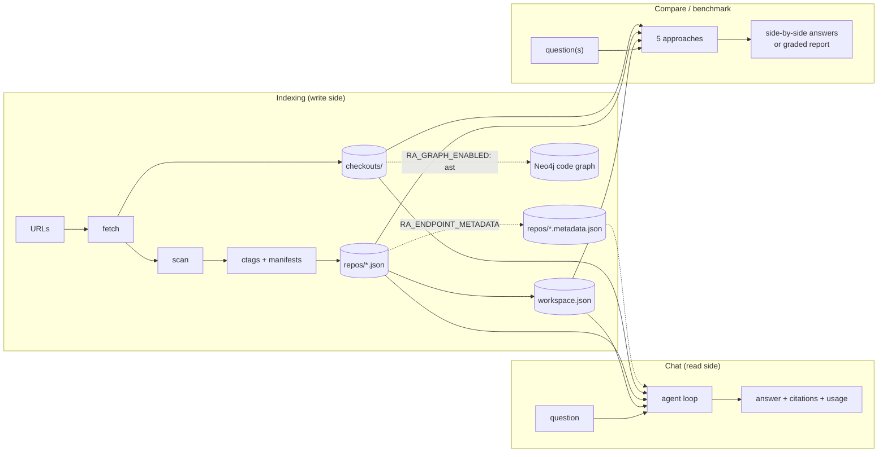
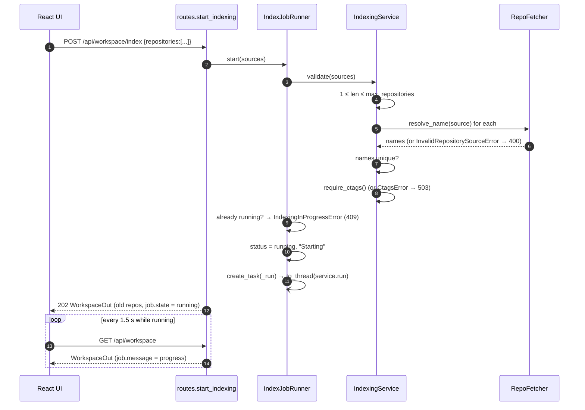
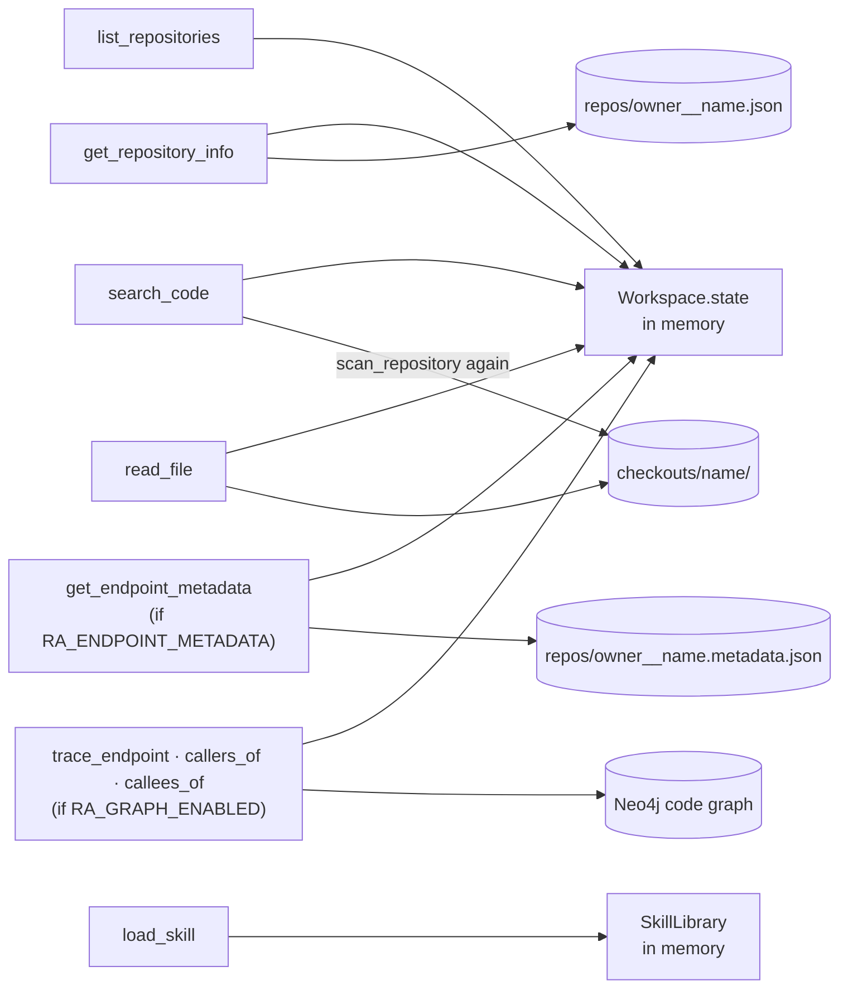
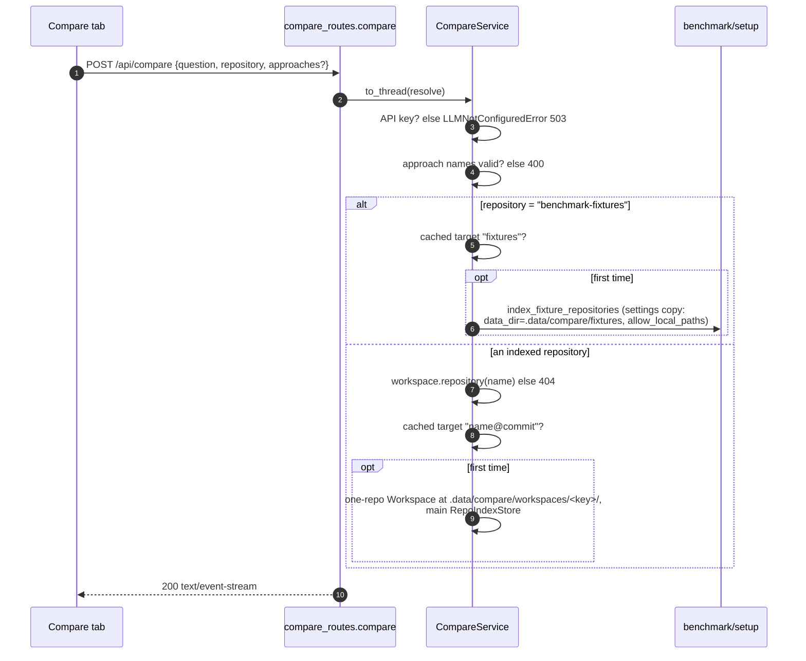
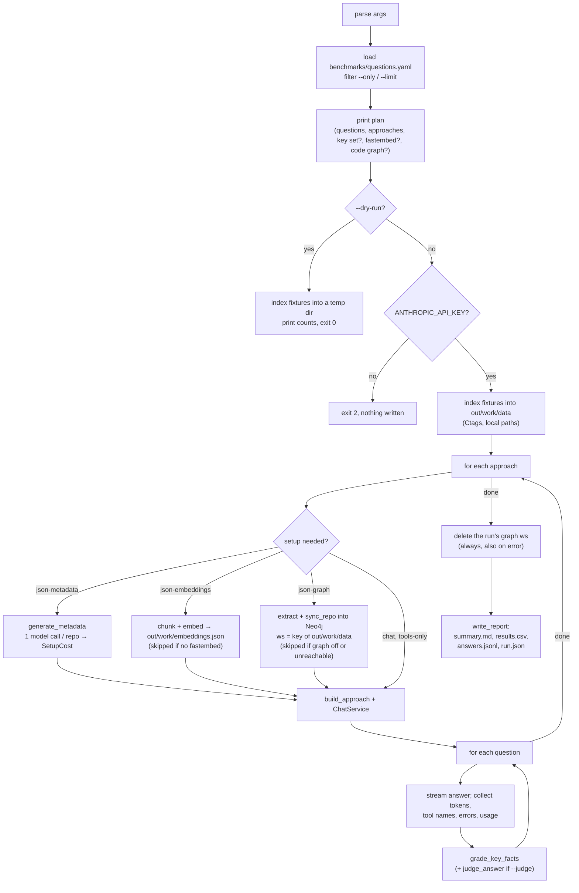
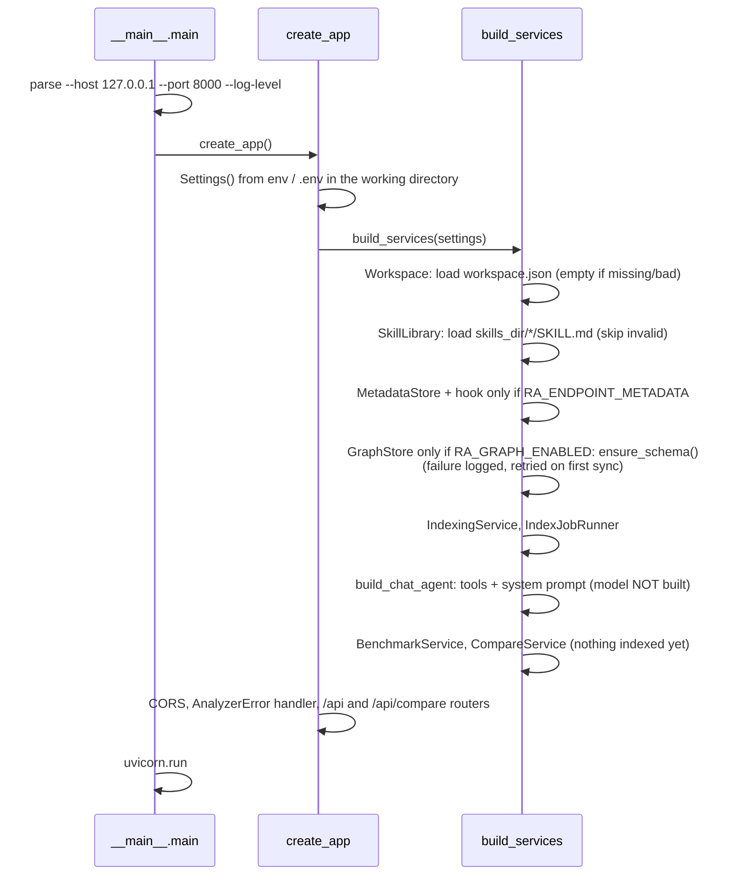

# Data flow

How data moves through the system: from repository URLs to JSON indexes on disk, from a
question to a streamed, cited answer, and through the Compare tab and the CLI benchmark.
Types and file formats are in [datamodels.md](datamodels.md); components in
[architecture.md](architecture.md).

---

## 1. The flows at a glance



Indexing writes; chat only reads. Compare and the benchmark index their own copies
(fixtures) or reuse an indexed repository, then generate whatever extra material an
approach needs (metadata, embeddings).

---

## 2. Indexing flow

### 2.1 Request to background job



Validation is synchronous, so bad input fails the POST before any clone starts.

### 2.2 Pipeline (`IndexingService.run`)

```mermaid
sequenceDiagram
    autonumber
    participant P as IndexingService.run
    participant F as RepoFetcher
    participant S as scanner
    participant B as build_repo_index
    participant C as ctags
    participant St as RepoIndexStore
    participant H as metadata hook
    participant MS as MetadataStore
    participant W as Workspace
    participant G as GraphStore (Neo4j)

    P->>P: validate again; previous = workspace.state; indexed_at = now
    loop each source
      Note over P: "[i/n] Fetching <source>"
      P->>F: fetch(source)
      F-->>P: RepoSnapshot (fresh shallow clone, or local dir)
      Note over P: "[i/n] Describing <name>"
      P->>S: scan_repository(name, root)
      S-->>B: SourceFile stream
      B->>C: one run, file list on stdin
      C-->>B: {path: FileSymbols}
      B->>B: per file: size, lines, symbols, parse_manifest
      B-->>P: RepoIndex dict
    end
    Note over P: "Writing JSON indexes"
    P->>St: save(index) for each (tmp + os.replace)
    opt RA_ENDPOINT_METADATA = true
      loop each repo  ("Describing endpoints in <name>")
        P->>H: describe_endpoints(index, root)
        H->>S: scan_repository again
        H->>H: select code files (≤ 150 000 chars), 1 model call, parse JSON
        alt success
          H-->>P: metadata
          P->>MS: save
        else any exception
          P->>MS: delete (index kept, warning logged)
        end
      end
    end
    P->>W: replace(WorkspaceState)  (persist, then swap)
    P->>St: delete stale indexes (and stale metadata)
    opt RA_GRAPH_ENABLED = true  ("Building code graph")
      P->>G: delete_repo(ws, name) for repos that left the workspace
      loop each repo
        P->>S: scan_repository again
        P->>P: extract_graph (ast, .sql) → GraphRecords
        P->>G: sync_repo(ws, repo, commit, records)<br/>one transaction: DETACH DELETE + UNWIND batches
      end
      Note over P,G: any exception → warning logged, indexing still succeeds
    end
    Note over P: "Indexed n repositories"
```

### 2.3 What each stage does to the data

| Stage | Input | Output | Filters / transforms |
| --- | --- | --- | --- |
| **Fetch** | URL | `RepoSnapshot` + checkout | https only; allow-listed host; no credentials/port/query/fragment; `/owner/name`; fresh `--depth 1` clone; `GIT_TERMINAL_PROMPT=0`; timeout |
| **Scan** | checkout root | sorted `SourceFile`s | Skip ignored dirs (`.git`, `node_modules`, `vendor`, `.venv`, `dist`, `build`, caches…), lockfiles, `.env*`, keys/certs, `*.min.js`, `*.map`, unknown types, symlinks, files > `max_file_bytes`, NUL bytes, non-UTF-8, whitespace-only |
| **Symbols** | accepted paths | `{path: FileSymbols}` | One Ctags run (`--output-format=json --fields=+nKselr --extras=+r --links=no`); drop pseudo-tags, markup/data languages, nested-in-function symbols, non-function/class kinds; `Class.method`; de-dupe |
| **Manifests** | each file | `Manifest` or nothing | Pure parsers; PEP 503 names; demote to `dev` under `examples/`, `tests/`, `docs/`… |
| **Describe** | all of the above | `RepoIndex` | Per-file size/lines; `stats`; flatten manifests/dependencies; **file text discarded** |
| **Write** | all indexes | `repos/<owner>__<name>.json` | Only after every repo succeeded; atomic |
| **Metadata** (opt.) | index + re-scanned code | `*.metadata.json` | Non-test code only, line-numbered, 150 000-char budget; model output normalised; failures never fail the run |
| **Swap** | `IndexedRepository`s | `workspace.json` + memory | Persist then swap under lock |
| **Clean up** | previous workspace | — | Delete index (and metadata) files no longer referenced; checkouts are not deleted |
| **Code graph** (opt.) | re-scanned files | Neo4j subgraph per repo (`ws`, `repo`) | Python `ast` + `.sql`; names, paths, lines, routes and table names only (no source text); calls resolved by name, gaps kept as `unresolved`; repos that left the workspace deleted first |

### 2.4 Failure behaviour

| Failure point | Result | State left behind |
| --- | --- | --- |
| Validation | POST 400 / 503 | Nothing changed |
| Job already running | POST 409 | Nothing changed |
| Clone fails / times out (repo *k*) | Job `failed` | Previous indexes and workspace intact; checkouts 1…*k*-1 refreshed; partial checkout *k* removed |
| Ctags fails / times out | Job `failed` | Same as above |
| Malformed manifest; unreadable/binary/oversized file | Skipped | Run continues |
| Metadata model call / parse fails, or no API key | Warning logged | That repo has no metadata file; indexing succeeds |
| Neo4j down, driver missing, bad credentials, or a Cypher error | Warning logged per repo | JSON indexes and workspace already written; that repo's previous subgraph is kept (the replace runs in one transaction); indexing succeeds |
| A Python file does not parse | Skipped by the graph extractor | Its functions are missing from the graph only |
| Unexpected exception | Job `failed`, generic message | Same as clone failure |
| Crash mid-write | — | Temp-file + rename: no truncated JSON |

Re-running the same request converges.

---

## 3. Chat flow

### 3.1 Request to stream

```mermaid
sequenceDiagram
    autonumber
    participant UI as React UI (Chat.tsx)
    participant R as routes.chat
    participant CS as ChatService
    participant G as LangGraph
    participant M as Claude (agent node)
    participant T as ToolNode

    UI->>R: POST /api/chat {thread_id, message}
    R->>R: schema check → 422
    R->>R: workspace empty? → 409
    R->>CS: ensure_ready() (no key → 503)
    R-->>UI: 200 text/event-stream
    R->>CS: stream(thread_id, message)
    CS->>CS: usage = UsageTracker()
    CS->>G: repair dangling tool_calls from an interrupted turn
    CS->>G: astream({messages:[HumanMessage]}, [messages, updates])
    loop until an AIMessage has no tool_calls (≤ recursion_limit)
      G->>M: [SystemMessage, *history] (cache_control ephemeral)
      M-->>CS: token chunks → event: token
      M-->>G: AIMessage(tool_calls)
      G-->>CS: updates(agent) → usage.add(AIMessage); event: tool_call ×n
      G->>T: run tools
      T-->>G: ToolMessage(content, artifact)
      G-->>CS: updates(tools) → event: sources
    end
    CS->>CS: usage.finish(); log "chat usage …"
    CS-->>UI: event: usage {input_tokens, …, latency_ms}
    CS-->>UI: event: done
```

### 3.2 Where each tool reads from



Each tool call takes a fresh `Workspace.state` snapshot, so a chat that overlaps an
indexing run sees either the old or the new set within one call, never a mix.

| Tool | Shaping before the model sees it |
| --- | --- |
| `list_repositories` | One line per repo, commit cut to 12 chars |
| `get_repository_info` | Optional `path` filter; compact JSON; > 40 000 chars → drop symbols, then trim files by ¾ steps, with a `note` |
| `search_code` | Optional `path`; substring or regex (≤ 300 chars, first 2 000 chars/line); first 60 hits, 240 chars each, plus total |
| `read_file` | Must stay inside root, indexable type, ≤ `max_file_bytes`, UTF-8; ≤ 400 numbered lines with a header |
| `load_skill` | Skill markdown, or an error listing names |
| `get_endpoint_metadata` | Whole metadata file as compact JSON, or "No endpoint metadata exists" |
| `trace_endpoint` | Route matched exactly or by `{param}` template; one indented line per step (`depth. function  repo/path:start-end  [called/passed as a function at line n]`), `reads/writes table x (line n)` under it, then gaps; no match → the repo's endpoint list; Neo4j errors → "Error: … use search_code" |
| `callers_of` / `callees_of` | Matched by name, `Class.method` or id; one line per function with its range and the call line |

Expected tool failures become `"Error: …"` text for the model; they do not end the turn.

### 3.3 LangGraph stream → UI events

| LangGraph part | Condition | Effect |
| --- | --- | --- |
| `messages` | `AIMessageChunk` from `agent` with text | `token {text}` |
| `updates` from `agent` | `AIMessage` | counted in `UsageTracker`; one `tool_call` per call |
| `updates` from `agent` | `stop_reason` `refusal` / `max_tokens` | `error` |
| `updates` from `tools` | `ToolMessage` with artifact | `sources` |
| exception | any | `error {message}` |
| end of turn | always | `usage`, then `done` |

### 3.4 Wire and client

`routes.chat` writes each `ChatEvent` as `event: <type>` / `data: <json>`. The browser
reads the POST body with `fetch` ([`api.ts`](../../frontend/src/api.ts)
`streamChat`, [`sse.ts`](../../frontend/src/sse.ts) parser); unknown event types are
ignored.

```
token     → append to the answer (```mermaid blocks render as diagrams)
tool_call → show an agent step
sources   → attach repo/path:start-end citations
error     → show the message
usage     → show "tokens in/out, cache, calls, latency" under the answer
done      → turn finished
```

### 3.5 Conversation memory

- History is keyed by `thread_id` in `InMemorySaver` and grows every turn (tool results
  included). The system prompt is not stored.
- Prompt caching keeps the repeated prefix cheap across model calls within a turn.
- A turn interrupted between tool request and tool results is repaired on the next turn
  with `"Not executed: the previous request was interrupted."` results.
- Lost on restart.

---

## 4. Compare flow

One free-form question, answered concurrently by several approaches
([`benchmark/compare.py`](../src/repo_analyzer/benchmark/compare.py)).

### 4.1 Resolve the target (before streaming)



### 4.2 Run the approaches

```mermaid
sequenceDiagram
    autonumber
    participant CSV as CompareService.events
    participant Q as asyncio.Queue
    participant A as task per approach
    participant T as CompareTarget
    participant CS as ChatService (new per approach)

    CSV-->>CSV: yield plan (available / reason per approach)
    CSV->>A: create_task for each runnable approach
    par each approach
      opt json-metadata
        A->>Q: setup "Preparing endpoint metadata"
        A->>T: ensure_metadata() (lock; reuse files on disk; once per target)
      end
      opt json-embeddings
        A->>Q: setup "Preparing code embeddings"
        A->>T: ensure_embeddings() (lock; chunk + embed; once per target)
      end
      opt json-graph
        A->>Q: setup "Loading the code graph"
        A->>T: ensure_graph(store) (lock; extract + sync_repo under the target's ws; once per target)
      end
      A->>A: build_approach → tools + prompt
      A->>Q: started
      A->>CS: stream("compare-<run>-<approach>", prepare_message(question))
      CS-->>A: token / tool_call / error / usage
      A->>Q: same, tagged with approach (usage adds setup cost)
      A->>Q: approach_done, END
    end
    loop until every task sent END
      Q-->>CSV: event → SSE
    end
    CSV-->>CSV: yield done (tasks cancelled if the client disconnects)
```

Notes:

- Each approach gets a brand-new `ChatService`, so there is no history across questions.
- Setup work (metadata model calls, embedding) is done once per target and cached in
  memory; its token cost is attached only to the `usage` event of the request that paid
  for it.
- `sources` events are not forwarded; the UI shows answers, tool steps and usage.
- For an indexed repository, metadata is written into the main `repos/` directory.
- `json-graph` uses `ws = graph_workspace_key(target data_dir)`: the fixtures target gets
  its own namespace (`<data_dir>/compare/fixtures`); an indexed repository reuses the main
  app's namespace, so its sync rewrites the same nodes the indexing run wrote.

---

## 5. CLI benchmark flow

`python -m repo_analyzer.benchmark` ([`benchmark/__main__.py`](../src/repo_analyzer/benchmark/__main__.py),
[`runner.py`](../src/repo_analyzer/benchmark/runner.py)).



| Step | Data in | Data out |
| --- | --- | --- |
| Index fixtures | `benchmarks/fixtures/{shop-api,shop-web}` | Indexes + workspace in `out/work/data` |
| Metadata setup | Index + code (≤ 150 000 chars per repo) | `*.metadata.json`, `SetupCost` |
| Embedding setup | All scanned files | 60-line chunks + vectors, `embeddings.json`, `SetupCost` |
| Graph setup | All scanned files | Nodes and edges in Neo4j under the run's `ws`, `SetupCost` (no tokens); deleted at the end |
| Answer | Question (+ top-k chunks for `json-embeddings`) | Answer text, tool names, `usage` dict |
| Grade | Answer + `key_facts` (+ `expected_answer` for the judge) | `FactGrade`, optional `JudgeVerdict` |
| Report | All `QuestionResult`s, setup costs, skipped approaches | Files in `benchmarks/results/<timestamp>/` |

Judge tokens are tracked separately and not added to any approach's totals.

---

## 6. Startup flow



No network calls at startup, except the Neo4j index setup when the graph is enabled. The
Anthropic client is created on first use; Ctags is probed
on `/health` and at each indexing request; fixtures are indexed on the first Compare
request that targets them.

---

## 7. Status reads

| Request | Reads | Side effects |
| --- | --- | --- |
| `GET /api/health` | `Settings`; `ctags --version`, `ctags --list-features`; Neo4j `verify_connectivity` when the graph is enabled | Two subprocesses (+ one Neo4j round trip) |
| `GET /api/skills` | `SkillLibrary` | none |
| `GET /api/workspace` | `Workspace.state` + `JobStatus` (memory, under locks) | none; `root` stripped |
| `GET /api/compare/status` | API key, fixtures on disk, workspace repos, `fastembed` importable | Reads `questions.yaml` |
