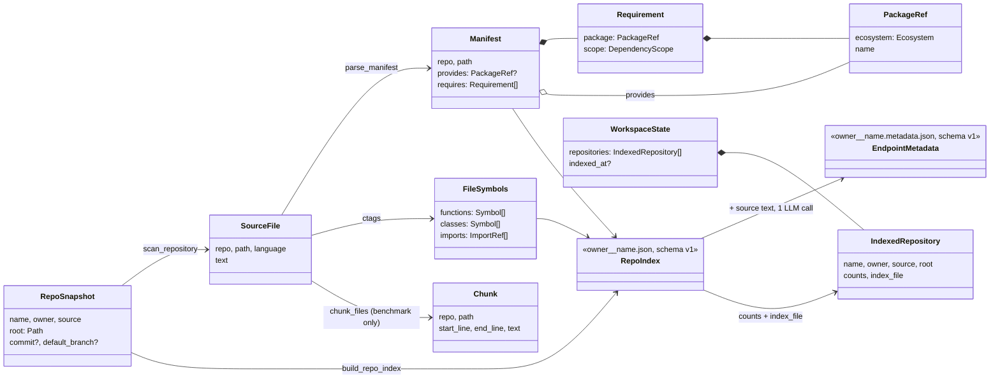
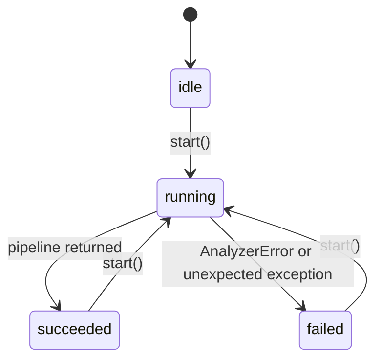

# Data models

Every type, file format and wire format in the backend, grouped by where it lives.
For how these are wired together see [architecture.md](architecture.md); for how data
moves between them see [dataflow.md](dataflow.md).

Conventions:

- In-process value types are **frozen dataclasses** (`frozen=True, slots=True`) unless
  noted; safe to share across threads.
- Timestamps are ISO 8601 UTC strings, second precision (`2026-11-22T11:30:00+00:00`).
- Repository-relative paths are POSIX (`src/flask/app.py`), never absolute.
- Line numbers are 1-based.

---

## 1. Overview



| Layer | Types | Module |
| --- | --- | --- |
| Domain | `Ecosystem`, `DependencyScope`, `RepoSnapshot`, `SourceFile`, `PackageRef`, `Requirement`, `Manifest` | `domain.py` |
| Symbols | `Symbol`, `ImportRef`, `FileSymbols` | `ingestion/symbols.py` |
| Index | `RepoIndex` (JSON dict) | `ingestion/repo_index.py` |
| Endpoint metadata | metadata JSON dict, `MetadataStore` | `ingestion/metadata.py` |
| Code graph | `GraphRecords` (+ 8 record types), `GraphStore`, `Trace`, `TraceStep` | `ingestion/graph_extract.py`, `ingestion/graph_store.py` |
| Workspace | `IndexedRepository`, `WorkspaceState` | `workspace.py` |
| Jobs | `JobState`, `JobStatus` | `ingestion/jobs.py` |
| Agent | `Skill`, `Source`, `ChatEvent`, `UsageTracker`, `MessagesState` | `agent/*.py` |
| Retrieval | `Chunk`, `EmbeddingIndex`, `Embedder` | `retrieval/embeddings.py` |
| Benchmark / Compare | `Question`, `QuestionSet`, `Approach`, `QuestionResult`, `BenchmarkResult`, `SetupCost`, `FactGrade`, `JudgeVerdict`, `CompareRequest`, `CompareTarget` | `benchmark/*.py` |
| API | `IndexRequest`, `ChatRequest`, `CompareIn`, `RepositoryOut`, `JobOut`, `WorkspaceOut`, `HealthOut`, `SkillOut` | `api/schemas.py`, `api/compare_routes.py` |
| Config | `Settings` | `config.py` |
| Errors | `AnalyzerError` hierarchy | `errors.py` |

---

## 2. Domain types ([`domain.py`](../src/repo_analyzer/domain.py))

No I/O; tests build them by hand.

### `Ecosystem` (StrEnum)

| Value | Manifests |
| --- | --- |
| `npm` | `package.json` |
| `pypi` | `pyproject.toml`, `setup.cfg`, `requirements*.txt` |
| `go` | `go.mod` |

### `DependencyScope` (StrEnum)

Serialised as `kind` in the JSON index.

| Value | Meaning |
| --- | --- |
| `runtime` | Needed to run the shipped package |
| `optional` | Extras / optional dependencies |
| `dev` | Development, test or tooling. Every manifest under `examples/`, `example/`, `samples/`, `demo/`, `docs/`, `doc/`, `tests/`, `test/` or `fixtures/` is demoted entirely to `dev`. |

### `RepoSnapshot`

A repository on local disk at a known revision. Produced by `RepoFetcher.fetch`.

| Field | Type | Notes |
| --- | --- | --- |
| `name` | `str` | Last URL segment minus `.git`, or local directory name; `^[A-Za-z0-9][A-Za-z0-9._-]{0,99}$` |
| `owner` | `str` | Second-to-last URL segment; `"local"` for a local directory |
| `source` | `str` | Canonical `https://host/owner/name`, or the resolved local path |
| `root` | `Path` | `<data_dir>/checkouts/<name>` for remotes; the directory itself for local paths |
| `commit` | `str \| None` | `git rev-parse HEAD`; `None` if git fails |
| `default_branch` | `str \| None` | `git branch --show-current`; `None` if detached or git fails |

### `SourceFile`

One file the scanner accepted. In memory only.

| Field | Type | Notes |
| --- | --- | --- |
| `repo` | `str` | Repository name |
| `path` | `str` | POSIX path relative to the repo root |
| `language` | `str` | Label from `LANGUAGE_BY_SUFFIX` / `LANGUAGE_BY_FILENAME` (`python`, `typescript`, `markdown`, `go-module`, `dockerfile`, …) |
| `text` | `str` | Full UTF-8 contents (non-empty, no NUL bytes, ≤ `max_file_bytes`) |

### `PackageRef`, `Requirement`, `Manifest`

| Type | Fields |
| --- | --- |
| `PackageRef` | `ecosystem: Ecosystem`, `name: str` (PyPI normalised per PEP 503; npm and Go verbatim) |
| `Requirement` | `package: PackageRef`, `scope: DependencyScope` |
| `Manifest` | `repo: str`, `path: str`, `provides: PackageRef \| None`, `requires: tuple[Requirement, ...]` |

How each manifest maps to scopes:

| File | `provides` | `runtime` | `optional` | `dev` |
| --- | --- | --- | --- | --- |
| `package.json` | `name` | `dependencies`, `peerDependencies` | `optionalDependencies` | `devDependencies` |
| `pyproject.toml` | `project.name` or `tool.poetry.name` | `project.dependencies`, `tool.poetry.dependencies` (minus `python`) | `project.optional-dependencies.*` | `dependency-groups.*`, `tool.poetry.group.*.dependencies` |
| `setup.cfg` | `metadata.name` | `options.install_requires` | `options.extras_require.*` | — |
| `requirements.txt` (exact name) | — | every requirement | — | — |
| `requirements-*.txt`, `requirements/*.txt` | — | — | — | every requirement |
| `go.mod` | `module` | every `require` | — | — |

Manifests with neither a name nor requirements yield nothing; unparseable files are
logged and skipped.

---

## 3. Symbol types ([`ingestion/symbols.py`](../src/repo_analyzer/ingestion/symbols.py))

| Type | Fields | Notes |
| --- | --- | --- |
| `Symbol` | `name: str`, `line: int`, `end_line: int \| None` | Methods are `Class.method`; Go `pkg.Type` scopes collapse to `Type`. `end_line` omitted from JSON when absent or equal to `line`. |
| `ImportRef` | `module: str`, `line: int` | `from pkg import Name` → `pkg` (de-duplicated) |
| `FileSymbols` | `functions`, `classes`: `tuple[Symbol, ...]`; `imports`: `tuple[ImportRef, ...]` | Each sorted by line; empty `FileSymbols` are not written |

### Ctags tag classification

| Category | Ctags kinds kept |
| --- | --- |
| **import** | Import role (`imported`, `namespace`, `required`, `included`, …) and kind in `module`, `package`, `library`, `header`, `script`, `unknown` |
| **class** | `class`, `struct`, `interface`, `trait`, `union`, protobuf `message`/`service`; Ruby `module`; Kotlin `object` |
| **function** | `function`, `func`, `generator`, `rpc`; `method`, `getter`, `setter`, `singletonMethod`, `methodSpec`; Python `member` inside a type |
| *dropped* | Variables, constants, properties, fields, enums, aliases, namespaces, packages, parameters, locals; anything nested inside a function; anything from markup/data languages |

---

## 4. The JSON index (schema v1) ([`ingestion/repo_index.py`](../src/repo_analyzer/ingestion/repo_index.py))

One file per repository at `<data_dir>/repos/<owner>__<name>.json`. In code it is a plain
`dict[str, Any]` aliased `RepoIndex`. It holds **no file contents and no model-written
text**.

File name: `index_filename(owner, name)` = `"{owner}__{name}.json"`, any character outside
`[A-Za-z0-9._-]` replaced by `_`.

```jsonc
{
  "schema_version": 1,
  "name": "flask",
  "owner": "pallets",                         // "local" for a local directory
  "url": "https://github.com/pallets/flask",  // RepoSnapshot.source
  "default_branch": "main",                   // or null
  "commit": "3f2a9c1d…",                      // or null
  "indexed_at": "2026-11-22T11:30:00+00:00",  // same for every repo in a run
  "stats": {
    "files": 214,                             // entries in "files"
    "lines": 31870,                           // sum of line_count
    "size_bytes": 1084312,                    // sum of size_bytes
    "languages": { "python": 96, "markdown": 41 } // file counts, desc
  },
  "manifests": [
    { "path": "pyproject.toml", "ecosystem": "pypi", "package": "flask" } // null/null if none provided
  ],
  "dependencies": [
    { "name": "jinja2", "ecosystem": "pypi", "kind": "runtime", "manifest": "pyproject.toml" }
  ],
  "files": [
    {
      "path": "src/flask/app.py",
      "language": "python",
      "size_bytes": 48210,                    // len(text.encode("utf-8"))
      "line_count": 1371,                     // len(text.splitlines())
      "symbols": {                            // only when something was found
        "functions": [{ "name": "Flask.run", "line": 612, "end_line": 702 }],
        "classes":   [{ "name": "Flask", "line": 108, "end_line": 1371 }],
        "imports":   [{ "module": "os", "line": 1 }]
      }
    }
  ]
}
```

| Path | Source |
| --- | --- |
| `schema_version` | `SCHEMA_VERSION = 1`; `RepoIndexStore.load` rejects anything else |
| `name`, `owner`, `url`, `default_branch`, `commit` | `RepoSnapshot` |
| `indexed_at` | Pipeline run start time |
| `stats.*` | Aggregated over accepted files |
| `manifests[]`, `dependencies[]` | `Manifest.provides`, flattened `Manifest.requires` |
| `files[]` | One per `SourceFile`, in scanner order (sorted walk) |
| `files[].symbols` | `FileSymbols.to_dict()` |

Derived counts on `IndexedRepository`: `file_count` = `stats.files`; `symbol_count` =
functions + classes (imports not counted); `dependency_count` = `len(dependencies)`.

### What the index is, and is not

The index is a **flat symbol table plus file tree**, not an abstract syntax tree.

| AST capability | In the index? |
| --- | --- |
| Where functions/classes/methods are declared (with line ranges) | Yes |
| Imports per file | Yes, as far as Ctags reports them (almost none for JS/TS) |
| Nesting | Only `Class.method` naming; functions nested in functions are dropped |
| Call graph, references, usages | No; the agent uses `search_code` (exact text) |
| Signatures, parameter/return types | No |
| Statements and expressions | No; the agent reads code with `read_file` |

The agent combines the index (where things are declared) with text search and file
reads (how they are used), and reasons over the real code.

### Agent view of the index

`get_repository_info` returns the index as compact JSON. With `path` it adds
`path_filter` and `files_matching` and keeps only files under that prefix. Above 40 000
characters it adds a `note` and shrinks: drop all `symbols`, then keep the first ¾ of
`files` repeatedly until it fits.

---

## 5. Endpoint metadata (schema v1) ([`ingestion/metadata.py`](../src/repo_analyzer/ingestion/metadata.py))

Optional, **model-written** description of how data flows through each endpoint. Written
to `<repos_dir>/<owner>__<name>.metadata.json` (name from `metadata_filename`). Produced
when `RA_ENDPOINT_METADATA=true` (at index time) or by the `json-metadata` benchmark/
Compare approach.

```jsonc
{
  "schema_version": 1,
  "repository": "shop-api",
  "owner": "local",
  "commit": "…",                            // from the index, may be null
  "generated_at": "2026-11-22T11:31:02+00:00",
  "model": "claude-opus-5-5",
  "files_read": ["app/main.py", "app/routers/customers.py"], // what the model saw
  "truncated": false,                       // true if the 150 000-char budget cut files
  "entries": [
    {
      "kind": "endpoint",                   // endpoint | client_call | job | other
      "name": "GET /customers/{customer_id}/summary",
      "handler": "app/routers/customers.py:customer_summary",
      "location": "app/routers/customers.py:31",
      "data_source": "One aggregate SQL query on orders …",
      "source_types": ["database", "cache"],// database | cache | external_api | computed | static | file | other
      "tables": ["orders"],
      "caching": "In-process, 60 s per customer", // or null
      "transformations": ["sums total_cents"],
      "side_effects": [],
      "external_calls": [],
      "notes": ""
    }
  ]
}
```

Input selection (`select_source_files`): code languages only (python, js, ts, go, rust,
java, kotlin, ruby, php, csharp, c, cpp, sql, graphql, protobuf, shell), test paths
excluded, sorted by path, line-numbered, up to 150 000 characters. The reply is parsed
leniently (fenced or bare JSON) and every entry normalised: unknown `kind` → `other`,
unknown `source_types` dropped, strings/lists coerced, entries without `name` dropped.

`MetadataStore` (`save` atomic, `load` returns `None` if missing/unreadable/wrong version,
`delete`). `get_endpoint_metadata` turns each `location` (`path:line`) into a `Source`.

---

## 6. Code graph ([`ingestion/graph_extract.py`](../src/repo_analyzer/ingestion/graph_extract.py), [`ingestion/graph_store.py`](../src/repo_analyzer/ingestion/graph_store.py))

Optional (`RA_GRAPH_ENABLED=true`). Derived from the checkout on every indexing run and
stored only in Neo4j; nothing is written to `RA_DATA_DIR`. Unlike the JSON index it has
call edges and table access, which is what makes request traces possible.

### Records (`extract_graph(files) -> GraphRecords`)

Frozen dataclasses; ids are deterministic strings so re-syncing is idempotent.

| Record | Fields | Notes |
| --- | --- | --- |
| `FileRecord` | `path`, `language` | Every file the scanner accepted |
| `FunctionRecord` | `id` (`"path:qualname"`), `name` (`func` or `Class.method`), `path`, `line`, `end_line`, `unresolved` | `line` is the `def` line; `unresolved` = call names that matched several functions (reported as trace gaps) |
| `ClassRecord` | `id`, `name`, `path`, `line`, `end_line` | |
| `ImportRecord` | `path`, `module`, `line`, `internal` | `internal`: the module is a file in this repository |
| `CallRecord` | `caller`, `callee` (function ids), `line`, `via` | `via` is `"call"` or `"reference"` (function passed as an argument) |
| `EndpointRecord` | `method` (upper case), `path` (router prefix included), `handler` (function id), `file`, `line` | FastAPI only |
| `TableRecord` | `name` (lower case, schema dropped), `declared_in` | `declared_in`: migration or model file, or `None` if only seen in SQL |
| `AccessRecord` | `function`, `table`, `kind` (`READS`/`WRITES`), `line` | One per (function, table, kind), earliest line |

### Neo4j model

| Label | Properties (all also have `ws`, `repo`) |
| --- | --- |
| `Repo` | `name`, `commit` |
| `File` | `path`, `language` |
| `Function` | `id`, `name`, `path`, `line`, `end_line`, `unresolved` |
| `Class` | `id`, `name`, `path`, `line`, `end_line` |
| `Module` | `name`, `internal` |
| `Endpoint` | `method`, `path`, `handler`, `file`, `line` |
| `Table` | `name`, `declared_in` |

```
(Repo)-[:CONTAINS]->(File)
(File)-[:DECLARES]->(Function|Class)
(File)-[:IMPORTS {line}]->(Module)
(Endpoint)-[:HANDLED_BY]->(Function)
(Function)-[:CALLS {line, via}]->(Function)
(Function)-[:READS {line}]->(Table)
(Function)-[:WRITES {line}]->(Table)
```

`ws` = `graph_workspace_key(data_dir)`: the first 12 hex characters of SHA-256 of the
resolved data directory. Range indexes (created with `IF NOT EXISTS`) cover `(ws, repo)`
on every label plus `File.path`, `Function.id`, `Function.name`, `Class.id`,
`Module.name`, `Table.name` and `Endpoint(method, path)`.

### Traces

`GraphStore.trace_endpoint(ws, repo, method, path) -> Trace | None`:

| Type | Fields |
| --- | --- |
| `Trace` | `method`, `path`, `file`, `line` (the endpoint), `steps`, `gaps` (`"caller: name"`), `truncated` (more than 60 steps) |
| `TraceStep` | `depth` (0 = handler), `function`, `function_id`, `path`, `line`, `end_line`, `via` (`None` for the handler), `call_line`, `tables` (`(table, kind, line)` tuples), `repeated` (already listed; callees not repeated) |

Steps are depth-first in call-line order, at most 6 calls deep. Routes match exactly
first, then by `{param}` template (`/customers/42/summary` → `/customers/{customer_id}/summary`).
`GraphStore.neighbours(ws, repo, function, "in"|"out")` returns callers or callees as
`{id, name, path, line, end_line, via, call_line, target}` rows (≤ 50).

Example for `POST /orders` in `benchmarks/fixtures/shop-api`:

```
0 create_order        app/routers/orders.py:33-84   reads customers, products; writes orders, order_items, products
1   connection        app/db.py:16-20
1   price_order       app/services/pricing.py:20-32
1   invalidate        app/cache.py:25-28
1   to_order          app/routers/orders.py:18-29
2     cents_to_dollars app/services/pricing.py:35-36
```

---

## 7. Workspace ([`workspace.py`](../src/repo_analyzer/workspace.py))

### `IndexedRepository`

| Field | Type | Notes |
| --- | --- | --- |
| `name` | `str` | Unique within a workspace; what tools take as `repo` |
| `owner`, `source` | `str` | |
| `root` | `str` | Server-side checkout path. **Never sent to API clients.** |
| `commit`, `default_branch` | `str \| None` | |
| `file_count`, `symbol_count`, `dependency_count` | `int` | |
| `index_file` | `str` | File name in `repos_dir` |

### `WorkspaceState` and `Workspace`

`WorkspaceState(repositories: tuple[IndexedRepository, ...] = (), indexed_at: str | None)`;
`repository(name)` returns the repo or raises `UnknownRepositoryError`.

`Workspace` holds the current snapshot under a `threading.Lock`; `replace(state)`
persists **then** swaps. Readers take one snapshot per operation.

### `workspace.json` (schema v2)

```json
{
  "schema_version": 2,
  "indexed_at": "2026-11-22T11:30:00+00:00",
  "repositories": [
    {
      "name": "flask", "owner": "pallets", "source": "https://github.com/pallets/flask",
      "root": ".data/checkouts/flask", "commit": "3f2a9c1d…", "default_branch": "main",
      "file_count": 214, "symbol_count": 1830, "dependency_count": 12,
      "index_file": "pallets__flask.json"
    }
  ]
}
```

A missing, unreadable, malformed or wrong-version file loads as an empty workspace.

---

## 8. Jobs ([`ingestion/jobs.py`](../src/repo_analyzer/ingestion/jobs.py))



`JobStatus` (in memory; a restarted server reports `idle`):

| Field | Type | Notes |
| --- | --- | --- |
| `state` | `JobState` | `idle` \| `running` \| `succeeded` \| `failed` |
| `message` | `str` | Latest progress: `[2/3] Fetching …`, `[2/3] Describing …`, `Writing JSON indexes`, `Describing endpoints in …`, `Indexed 3 repositories` |
| `error` | `str \| None` | `AnalyzerError` message, or a generic message |
| `started_at`, `finished_at` | `str \| None` | |

`start()` while `running` raises `IndexingInProgressError` (409).

---

## 9. Agent types

### `Skill` ([`agent/skills.py`](../src/repo_analyzer/agent/skills.py))

| Field | Rules |
| --- | --- |
| `name` | 1–64 chars, `^[a-z0-9]+(-[a-z0-9]+)*$`, equals the directory name, no `anthropic`/`claude`, no `<`/`>` |
| `description` | 1–1024 chars, no `<`/`>` |
| `body` | Markdown after the frontmatter |

Source: `skills/<name>/SKILL.md` with frontmatter containing only `name` and
`description` (plain, quoted, or `|`/`>` block scalars). `SkillLibrary` is name-sorted so
the catalogue is stable and prompt-cacheable.

### `Source` (tool artifact)

```json
{ "repo": "flask", "path": "src/flask/app.py", "start_line": 612, "end_line": 702 }
```

| Tool | Sources emitted |
| --- | --- |
| `get_repository_info` | Each manifest at line 1 (≤ 20) |
| `search_code` | Each shown hit (≤ 60) |
| `read_file` | The returned range |
| `get_endpoint_metadata` | Each entry `location` (≤ 20) |
| `semantic_search` | Each returned chunk |
| `trace_endpoint` | Each step's function range (handler first, ≤ 60) |
| `callers_of`, `callees_of` | Each listed function's range (≤ 50) |
| `list_repositories`, `load_skill`, `list_files` | none |

### Conversation state

LangGraph `MessagesState` (`{"messages": [...]}`, append reducer), checkpointed per
`thread_id` in `InMemorySaver`. A turn appends `HumanMessage` → `AIMessage(tool_calls)` →
`ToolMessage`* → … → final `AIMessage`. The `SystemMessage` is prepended on every call and
is not stored.

### `UsageTracker` ([`agent/usage.py`](../src/repo_analyzer/agent/usage.py))

Mutable dataclass summing every model response in one turn (or one setup step).

| Field | Meaning |
| --- | --- |
| `input_tokens` | Includes prompt-cache reads and writes (LangChain's Anthropic convention) |
| `output_tokens`, `total_tokens` | |
| `cache_read_tokens`, `cache_creation_tokens` | From `usage_metadata.input_token_details` |
| `llm_calls` | Model responses counted |
| `tool_calls` | Tool calls those responses requested |
| `latency_ms` | Wall clock from creation to `finish()` |

`to_dict()` gives those eight keys; it is the payload of the `usage` event.

### `ChatEvent` ([`agent/service.py`](../src/repo_analyzer/agent/service.py))

`ChatEvent(type, data: dict = {})`:

| `type` | `data` | Emitted when |
| --- | --- | --- |
| `token` | `{"text"}` | A text chunk from the `agent` node |
| `tool_call` | `{"name", "args"}` | The agent asks for tools (one per call) |
| `sources` | `{"sources": Source[]}` | A tool returns a non-empty artifact |
| `error` | `{"message"}` | Any failure, `refusal` or `max_tokens` stop reason |
| `usage` | `UsageTracker.to_dict()` | Always, just before `done` (also after errors) |
| `done` | `{}` | Always last, exactly once |

---

## 10. Retrieval types ([`retrieval/embeddings.py`](../src/repo_analyzer/retrieval/embeddings.py))

Used only by the `json-embeddings` approach.

| Type | Fields / contract |
| --- | --- |
| `Embedder` (Protocol) | `name: str`; `embed(texts) -> list[list[float]]` |
| `FastEmbedEmbedder` | `fastembed.TextEmbedding`, default `BAAI/bge-small-en-v1.5`; raises `EmbeddingsUnavailableError` if the extra is missing |
| `Chunk` | `repo`, `path`, `start_line`, `end_line`, `text`: a 60-line window, 15-line overlap, whitespace-only windows skipped |
| `EmbeddingIndex` | `embedder`, `chunks`, unit-normalised `vectors`; `search(query, k, repo?)` by cosine similarity; embedded text is `"{repo}/{path}\n{text}"` |

Saved form (benchmark only, `<out>/work/embeddings.json`):

```json
{ "embedder": "BAAI/bge-small-en-v1.5",
  "chunks": [{ "repo": "shop-api", "path": "app/db.py", "start_line": 1, "end_line": 20, "text": "…" }],
  "vectors": [[0.012, -0.044, …]] }
```

`load` refuses a file built with a different embedder name.

---

## 11. Benchmark and Compare types ([`benchmark/`](../src/repo_analyzer/benchmark/))

### Questions file: `benchmarks/questions.yaml` (version 1)

```yaml
version: 1
repositories: [shop-api, shop-web]       # folders under benchmarks/fixtures/
questions:
  - id: summary-data-source              # stable identifier
    category: data-source                # data-source | caching | schema | flow | transformation | external | frontend | config | trace
    question: Where does the GET /customers/{customer_id}/summary endpoint get its data from?
    expected_answer: >-
      It runs one aggregate SQL query on the PostgreSQL `orders` table …
    key_facts: ["orders", "paid", "fulfilled", "60 | sixty", "cache"]  # " | " = alternatives
    evidence: [shop-api/app/routers/customers.py]                    # checked to exist by tests
```

Loaded into `Question(id, category, question, expected_answer, key_facts, evidence)` and
`QuestionSet(repositories, questions)`.

### Approach

| Type | Fields |
| --- | --- |
| `Approach` | `name`, `tools: list[BaseTool]`, `system_prompt`, `prepare_message(question) -> str` (identity except `json-embeddings`, which appends a `<retrieved_code>` block) |
| `ApproachContext` (mutable) | `settings`, `index_store`, `workspace`, `metadata_store?`, `embedding_index?`, `graph_store?`, `graph_ws = ""`, `top_k = 8` |
| `SetupCost` (mutable) | `approach`, `description`, `usage: dict[str, int]` (UsageTracker dict) |

`APPROACHES = ("chat", "json-metadata", "tools-only", "json-embeddings", "json-graph")`.

### Grading

| Type | Fields |
| --- | --- |
| `FactGrade` | `matched`, `missing` (tuples of facts); `score = matched/total`; `correct = total > 0 and no missing` |
| `JudgeVerdict` | `correct: bool \| None` (`None` if the judge reply is unreadable), `reason: str` |

Key-fact match: lowercase, strip `` ` `` and `*`, unify quotes/dashes/whitespace, then
substring test of any `|` alternative.

### Results (CLI)

`QuestionResult` (one per approach × question): `approach`, `question_id`, `category`,
`answer`, `facts_matched`, `facts_total`, `missing_facts`, `matched_facts`, `correct`,
`judge_correct`, `judge_reason`, the eight usage counters, `tools_used`, `error`.

`BenchmarkResult`: `results`, `skipped: {approach: reason}`, `setup: SetupCost[]`,
`judge_usage`.

Output directory `benchmarks/results/<YYYYmmdd-HHMMSS>/`:

| File | Content |
| --- | --- |
| `summary.md` | Per-approach table and a question × approach grid |
| `results.csv` | `approach, question_id, category, correct, facts_matched, facts_total, judge_correct, input_tokens, output_tokens, total_tokens, cache_read_tokens, cache_creation_tokens, llm_calls, tool_calls, latency_ms, error` |
| `answers.jsonl` | Full `QuestionResult` per line |
| `run.json` | Run info (model, effort, start time, fixture commit), skipped approaches, summary |
| `work/` | `data/` (fixture indexes + metadata), `embeddings.json` |

### Compare

| Type | Fields |
| --- | --- |
| `CompareRequest` | `question`, `repository = "benchmark-fixtures"`, `approaches: list[str] \| None` |
| `CompareTarget` (mutable, cached) | `key`, `label`, `settings`, `index_store`, `workspace`, `setup: ApproachSetup`, `metadata_store?`, `embedding_index?`, `graph_ws?` (set once the graph is loaded), `lock` |

Target keys: `"fixtures"`, or `"<name>@<commit or index_file>"` for an indexed repo.

**`GET /api/compare/status`**:

```jsonc
{
  "llm_configured": true,
  "llm_message": null,                       // explanation when not configured
  "llm_model": "claude-opus-5-5",
  "repositories": [
    { "id": "benchmark-fixtures", "label": "Benchmark fixtures (shop-api + shop-web)", "kind": "fixtures" },
    { "id": "flask", "label": "pallets/flask", "kind": "workspace" }
  ],
  "approaches": [
    { "name": "json-embeddings", "label": "json-embeddings",
      "summary": "Ctags JSON index + the top-k most similar code chunks; no code access",
      "available": false, "reason": "fastembed is not installed (pip install -e \".[embeddings]\")" },
    { "name": "json-graph", "label": "json-graph",
      "summary": "Ctags JSON index + Neo4j code graph (endpoint to functions to tables); no code access",
      "available": false, "reason": "the code graph is off (set RA_GRAPH_ENABLED=true and NEO4J_PASSWORD)" }
  ]
}
```

**`POST /api/compare` events** (SSE; `event:` = `type`, `data:` = the whole object):

| `type` | Extra fields | Notes |
| --- | --- | --- |
| `plan` | `question`, `repository`, `label`, `approaches[]` (as in status) | First |
| `setup` | `approach`, `message` | Metadata/embeddings being prepared |
| `started` | `approach` | Agent begins |
| `token` | `approach`, `text` | |
| `tool_call` | `approach`, `name`, `args` | |
| `error` | `approach`, `message` | |
| `unavailable` | `approach`, `reason` | Prerequisite missing at run time |
| `usage` | `approach`, `usage` (8 counters), `setup: {description, total_tokens} \| null` | `setup` only for the request that paid for it |
| `approach_done` | `approach` | One per approach |
| `done` | — | Last |

`sources` events are not forwarded by Compare.

---

## 12. HTTP API schemas ([`api/schemas.py`](../src/repo_analyzer/api/schemas.py))

Pydantic v2. Mirrored in [`frontend/src/api.ts`](../../frontend/src/api.ts) and
[`frontend/src/compare/types.ts`](../../frontend/src/compare/types.ts).

### Requests

| Model | Route | Fields |
| --- | --- | --- |
| `IndexRequest` | `POST /api/workspace/index` | `repositories: list[str]` (≥ 1; then ≤ `max_repositories`, valid URLs, unique names, Ctags present) |
| `ChatRequest` | `POST /api/chat` | `thread_id` (`^[A-Za-z0-9_-]{1,64}$`), `message` (1–8 000 chars) |
| `CompareIn` | `POST /api/compare` | `question` (1–8 000), `repository` (default `benchmark-fixtures`, ≤ 200), `approaches` (optional subset) |

### Responses

| Model | Fields |
| --- | --- |
| `WorkspaceOut` | `repositories: RepositoryOut[]`, `indexed_at`, `job: JobOut` |
| `RepositoryOut` | `IndexedRepository` **without `root`** |
| `JobOut` | `state`, `message`, `error`, `started_at`, `finished_at` |
| `HealthOut` | `status: "ok"`, `llm_configured` (non-empty API key), `llm_model`, `ctags_available`, `ctags_version`, `graph_available` (graph enabled and Neo4j reachable) |
| `SkillOut` | `name`, `description` |
| error body | `{"detail": str}` (validation errors: `{"detail": [{"msg": …}]}`) |

### Chat SSE wire format

```
event: tool_call
data: {"name": "search_code", "args": {"query": "def run", "repo": "flask"}}

event: sources
data: {"sources": [{"repo": "flask", "path": "src/flask/app.py", "start_line": 612, "end_line": 612}]}

event: token
data: {"text": "`Flask.run` starts the development server"}

event: usage
data: {"input_tokens": 18234, "output_tokens": 412, "total_tokens": 18646, "cache_read_tokens": 12800, "cache_creation_tokens": 3100, "llm_calls": 3, "tool_calls": 2, "latency_ms": 9412}

event: done
data: {}
```

---

## 13. Configuration ([`config.py`](../src/repo_analyzer/config.py))

`Settings` (pydantic-settings, prefix `RA_`, reads `.env`). Full list in
[architecture.md §12](architecture.md#12-configuration-reference).

| Derived property | Value |
| --- | --- |
| `checkouts_dir` | `data_dir / "checkouts"` |
| `repos_dir` | `data_dir / "repos"` |
| `workspace_file` | `data_dir / "workspace.json"` |

`anthropic_api_key` (from `ANTHROPIC_API_KEY`) and `neo4j_password` (from
`NEO4J_PASSWORD`) are `SecretStr`s read without the `RA_` prefix.

The benchmark and Compare derive their own settings with `model_copy(update={"data_dir": …,
"allow_local_paths": True})`.

---

## 14. Errors ([`errors.py`](../src/repo_analyzer/errors.py))

```
AnalyzerError                         (message is safe to show callers)
├── InvalidRepositorySourceError      400  bad URL/host/path, too many, duplicates, local disabled
├── InvalidBenchmarkRequestError      400  unknown approach or fixture name
├── UnknownRepositoryError            404  name not in workspace; index file missing/unsupported
├── IndexingInProgressError           409  a job is already running
├── WorkspaceEmptyError               409  chat before anything is indexed
├── RepositoryFetchError              502  clone failed/timed out, git missing
├── LLMNotConfiguredError             503  no ANTHROPIC_API_KEY
├── CtagsError                        503  Ctags missing, not Universal, no JSON, failed, timed out
├── BenchmarkUnavailableError         503  questions.yaml or fixtures not found
├── GraphUnavailableError             503  graph enabled but the neo4j driver is missing
├── MetadataGenerationError           —    caught by the pipeline / reported per approach
└── EmbeddingsUnavailableError        —    fastembed missing; approach skipped
```

All of these subclass `AnalyzerError` from `errors.py`, but `MetadataGenerationError` is
defined in `ingestion/metadata.py` and `EmbeddingsUnavailableError` in
`retrieval/embeddings.py`.

Internal only: `SkillParseError(ValueError)` (skill skipped), `ApproachUnavailableError`
(approach skipped / `unavailable` event).

---

## 15. On-disk layout

```
<RA_DATA_DIR>/                         default ./.data (relative to the server's cwd)
├── workspace.json                     WorkspaceState, schema v2
├── checkouts/<name>/                  shallow clone, replaced on every index run
├── repos/
│   ├── <owner>__<name>.json           RepoIndex, schema v1
│   └── <owner>__<name>.metadata.json  endpoint metadata, schema v1 (optional)
└── compare/
    ├── fixtures/                      Compare's own data dir for the fixture apps
    │   ├── workspace.json
    │   └── repos/local__shop-api.json, …metadata.json
    └── workspaces/<name>@<commit>/workspace.json   one-repo workspace per Compare target
(*.json.tmp files appear briefly during atomic writes)

backend/skills/<name>/SKILL.md         Agent Skills (packaged as repo_analyzer/skills in a wheel)
benchmarks/questions.yaml              benchmark questions
benchmarks/fixtures/{shop-api,shop-web} known-answer fixture apps (read in place)
benchmarks/results/<timestamp>/        CLI benchmark output (git-ignored)
```

### Persistence summary

| Data | Storage | Survives restart |
| --- | --- | --- |
| Workspace | `workspace.json` | yes |
| Per-repo index | `repos/*.json` | yes |
| Endpoint metadata | `repos/*.metadata.json` | yes |
| Checkouts | `checkouts/<name>/` | yes |
| Indexing job status | memory | no (reports `idle`) |
| Chat threads | `InMemorySaver` | no |
| Compare targets and embedding indexes | memory (metadata/indexes on disk are reused) | no |
| Code graph | Neo4j (nodes tagged with `ws`, `repo`) | yes, in Neo4j; rebuilt on every indexing run |
| Skills | `SKILL.md`, loaded at startup | yes (reload needs restart) |
