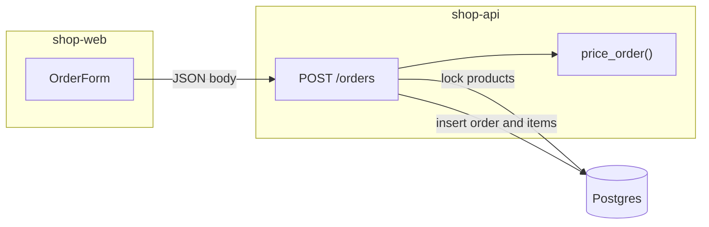

# Draw diagrams

The chat renders fenced `mermaid` code blocks as diagrams. When an answer
explains how something flows or how parts connect, show it as a Mermaid
flowchart instead of a README-style table or a long list of arrows in prose.

Use a diagram for: a request or feature traced through files, data moving from
a source through caches and transformations to the UI, an architecture
overview, the steps of a pipeline, calls between repositories or services, and
state changes such as an order's status lifecycle.

Do not use one for a single fact, a short list, or content that is genuinely a
table (items that share the same attributes, such as config settings with
their defaults). Use a markdown table only for that.

## How to write it

1. Lead with the direct answer in a sentence or two, then the diagram, then
   the supporting evidence with `repo/path:line` citations. The diagram adds to
   the citations; it does not replace them.
2. Write one fenced block that starts with ` ```mermaid ` and then
   `flowchart TD` (top to bottom) or `flowchart LR` (left to right).
3. Only draw nodes and edges the tools showed you. If a step could not be
   established, leave it out and say so in the text.
4. Keep it small: about 12 nodes at most. Split a larger flow into two
   diagrams or summarise the less important parts.
5. Use short ids and put every label in double quotes, because parentheses,
   colons, slashes and braces break unquoted labels:
   `orders["POST /orders (routers/orders.py)"]`. Do not put HTML, backticks,
   or double quotes inside a label.
6. Label edges with what moves or happens: `api -->|"SELECT ... FOR UPDATE"| db`.
7. Group nodes from the same repository or layer with `subgraph`. Draw
   databases and caches as cylinders, `db[("Postgres")]`, and decisions as
   diamonds, `paid{"status is paid?"}`.

## Example


